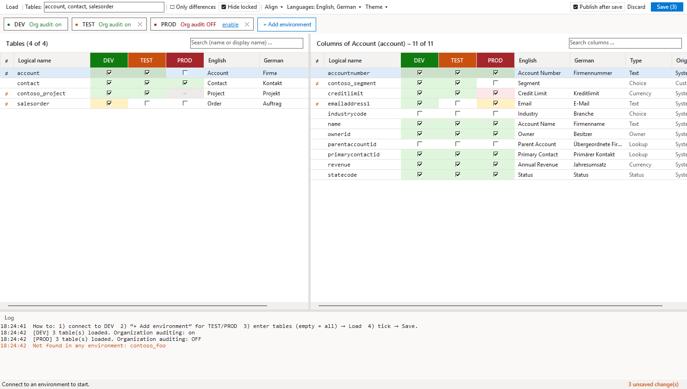
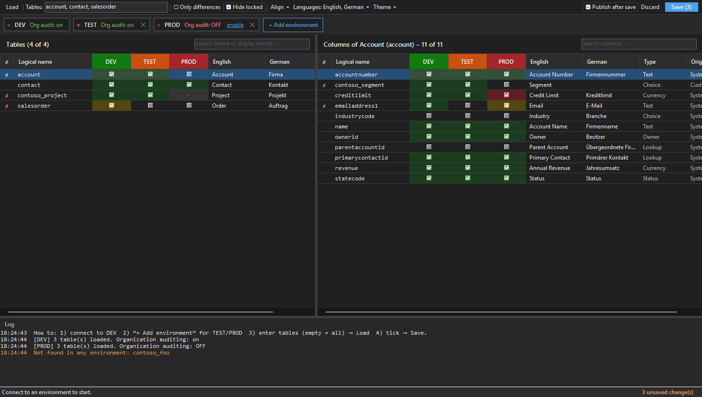
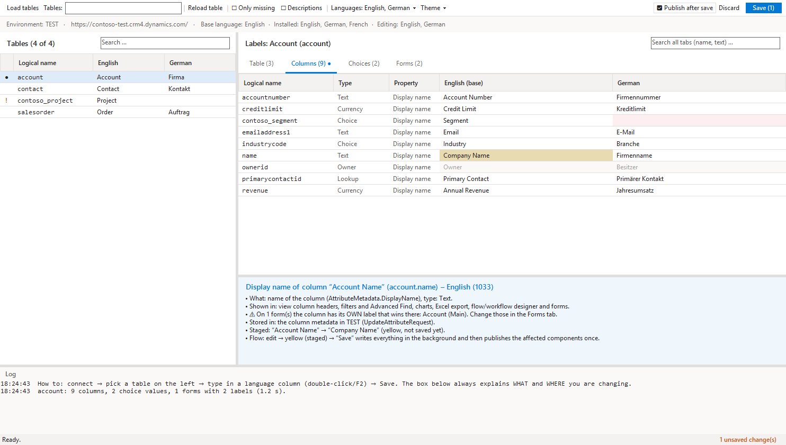
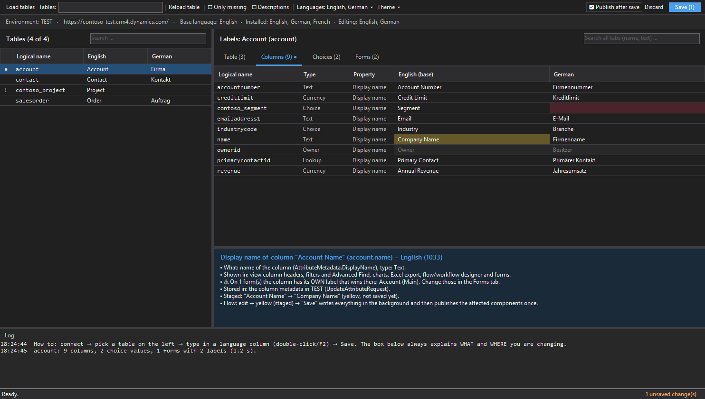

# D365 Audit Manager & D365 Translation Manager

Two [XrmToolBox](https://www.xrmtoolbox.com) tools for Dynamics 365 / Dataverse.

| Tool | What it does |
|---|---|
| **D365 Audit Manager** | Shows organization, table and column auditing for several environments (e.g. DEV / TEST / PROD) side by side, highlights differences, lets you tick/untick or copy settings between environments, and saves in the background. |
| **D365 Translation Manager** | Shows the labels of tables, columns, choices and forms in any installed language, lets you edit them inline, explains for every cell *what* you change and *where* it is stored, and saves in the background. |

Both tools: display names in the **base language + first additional language** by default, more languages via the **Languages** menu (remembered per tool) · **light and dark theme** (Theme menu: Windows default / Light / Dark) · saving never freezes XrmToolBox · only what changed is published.

## D365 Audit Manager

| Light | Dark |
|---|---|
|  |  |

1. Connect to your first environment (e.g. DEV).
2. **+ Add environment** → add TEST and PROD. Each environment becomes a column (in its XrmToolBox environment colour).
3. Enter tables, e.g. `account, contact, salesorder` (empty = all) → **Load** (F5).
4. Tick/untick → **Save** (Ctrl+S).

| Colour | Meaning |
|---|---|
| green | auditing enabled |
| white | disabled |
| yellow | changed, not saved yet |
| red | error on last save (tooltip shows the message) |
| grey “–” | table/column does not exist in this environment |
| `≠` | auditing differs between environments |

- **Right-click an environment column header**: enable/disable all visible rows there, or undo.
- **Align**: copy the settings of the selected tables (incl. all columns) from one environment to others, e.g. DEV → TEST + PROD.
- **Only differences**, **Hide locked** (audit setting locked by a managed property), search boxes.
- Select several rows + Space toggles them together in the current environment column.
- The environment bar shows **organization-wide auditing**; if it is off you can enable it there. A column is only audited when organization **and** table **and** column auditing are on – tooltips point this out.

**Saving:** environments in parallel, sequential within one environment (Dataverse locks metadata changes).
Per table/column: `RetrieveEntity`/`RetrieveAttribute` → set `IsAuditEnabled` → `UpdateEntity`/`UpdateAttribute`;
then one `PublishXml` per environment for the affected tables only.

## D365 Translation Manager

| Light | Dark |
|---|---|
|  |  |

1. Connect to an environment – the table list loads automatically.
2. Pick a table → tabs **Table**, **Columns**, **Choices**, **Forms**.
3. Type in a language column (double-click / F2) → yellow → **Save** (Ctrl+S).

The box **“What am I changing – and where?”** explains the selected cell: which metadata property it is,
where users see it, where it is stored – and warns about **global choices** (used in other tables too),
**form labels that override** the column display name, and items from **managed solutions** (the change becomes an active-layer customization).

| Tab | Texts | Saved with |
|---|---|---|
| Table | display name, plural name, description | `UpdateEntityRequest` |
| Columns | display name, description (toggle “Descriptions”) | `UpdateAttributeRequest` |
| Choices | choice / multi-select values, status reason, status, yes/no – local and global | `UpdateOptionValueRequest`, `UpdateStateValueRequest`, `UpdateAttributeRequest`, `UpdateOptionSetRequest` |
| Forms | labels of tabs, sections and fields on main, quick create, quick view and card forms | `systemform.formxml` |

Why it is fast: changes are batched (one request per table / column / choice value / form, `MergeLabels` so other languages stay untouched)
and published **once** at the end for the affected components – in the background.

Filters: **Only missing** (pink = missing text in a selected language), search across all tabs.
Grey cells are locked (`IsRenameable = false` or a non-customizable choice).

Not covered: view names, sitemap titles, dashboards, business process flows, web resources.

## Install

- **From the Tool Library** (after publishing): search for “D365 Audit Manager” / “D365 Translation Manager”.
- **Manually / for testing:** see [TESTING.md](TESTING.md) – `deploy.ps1` builds and copies the DLLs into XrmToolBox's `Plugins` folder.

## Build

Requirements: .NET SDK 6 or later (builds .NET Framework 4.8 via reference assemblies – no Visual Studio needed; VS 2022 opens `D365Tools.sln` as well).

```powershell
dotnet build D365Tools.sln -c Release
```

```
Directory.Build.props        repository URL, author, version – used by DLLs and NuGet packages
src/Shared/                  shared code (metadata helpers, theme, languages, settings), compiled into both DLLs
src/D365AuditManager/        tool 1 (MultipleConnectionsPluginControlBase) + .nuspec
src/D365TranslationManager/  tool 2 (PluginControlBase) + .nuspec
tools/UiPreview/             screenshots + smoke test without Dataverse (see TESTING.md)
tools/generate-icons.ps1     tool logos (PluginIcons.cs + docs/icons/*.png)
deploy.ps1                   build + copy into an XrmToolBox Plugins folder
pack.ps1                     NuGet packages for the Tool Library + checklist validation
```

Both DLLs are self-contained (no extra assemblies in the Plugins folder).

## Roadmap

The goal is generic tools that anyone can adapt to their own way of working: every tool gets the same multi-environment view (DEV / TEST / PROD side by side), and configurations can be saved and shared.

### D365 Audit Manager

- [ ] **Baseline export/import** – save the audit configuration as JSON/CSV, keep it in source control, compare any environment against it and apply it.
- [ ] **Solution-aware (ALM)** – filter by solution and add changes to an unmanaged solution instead of changing TEST/PROD directly.
- [ ] **Organization settings & audit log** – user access auditing, retention period, audit log size per table, audit history of a record.
- [ ] **Bulk rules** – e.g. “all custom columns on”, “everything except system columns”, name patterns – across tables and environments.

### D365 Translation Manager

- [ ] **Export/import for translators or AI** – export all labels as Excel, CSV or JSON, translate them with any AI or translator, import the result, then review the changes table → column → form one by one or apply all at once, and save and publish.
- [ ] **More components** – view names, sitemap, dashboards, business process flow stages, app names, business rule messages, web resources (RESX).
- [ ] **Search & replace + checks** – rename a term everywhere with preview, glossary, consistency and typo checks, compare labels between environments.

### New tools (all with the multi-environment view)

- [ ] **Environment Variables** – values of all environment variables in DEV/TEST/PROD side by side, highlight differences, set values.
- [ ] **Metadata Compare** – drift between environments: columns, choice values, forms, views, plugin steps.
- [ ] **Security Role Compare** – privileges of security roles and column security profiles across environments, and align them.
- [ ] **Plugin & API Overview** – plugin steps, custom APIs, webhooks and flows per environment, incl. enabled/disabled.

Ideas and votes are welcome as [GitHub issues](https://github.com/Itsum/d365-xrmtoolbox-tools/issues).

## License

[MIT](LICENSE)
