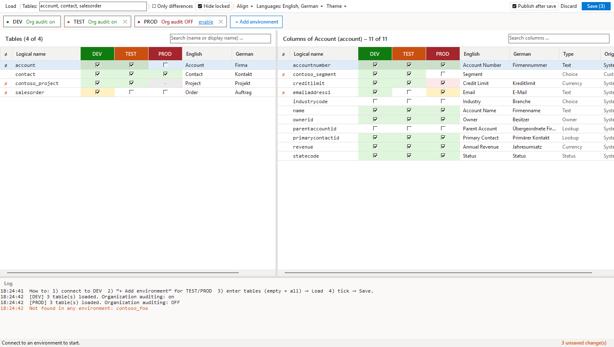

# D365 Audit Manager

An **[XrmToolBox](https://www.xrmtoolbox.com)** tool for Dynamics 365 / Dataverse. Install it from the XrmToolBox **Tool Library** – this package is not meant to be referenced from code.

Compare and change auditing of tables and columns across several environments (e.g. DEV / TEST / PROD) side by side.

## Features

- One column per connected environment (main connection + “Add environment”), in the XrmToolBox environment colour
- Organization, table and column auditing at a glance; `≠` marks differences, grey “–” marks items missing in an environment
- Tick/untick, right-click a column header to enable/disable all visible rows, or **Align** settings from one environment to others
- **Save in the background** – environments in parallel; only the affected tables are published
- Display names in the base language + first additional language, more via the **Languages** menu
- Light and dark theme

## How to use

1. Connect to your first environment, then **+ Add environment** for TEST and PROD.
2. Enter tables (e.g. `account, contact, salesorder`, empty = all) → **Load**.
3. Tick/untick → **Save**.

Source, documentation and issues: <https://github.com/Itsum/d365-xrmtoolbox-tools>

License: MIT
