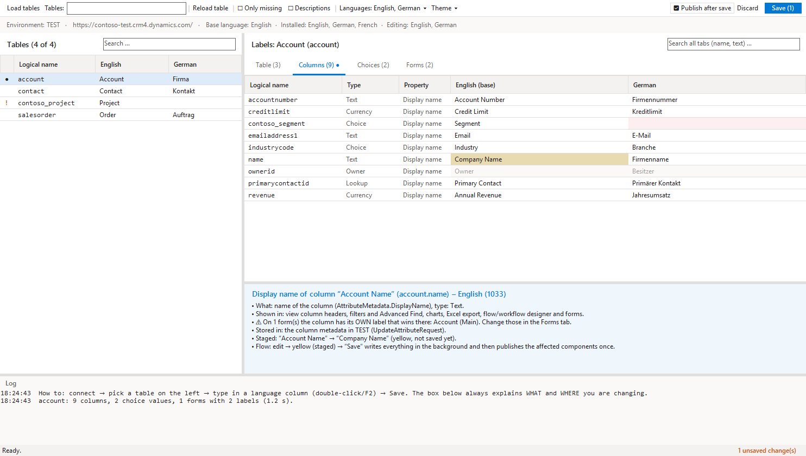

# D365 Translation Manager

An **[XrmToolBox](https://www.xrmtoolbox.com)** tool for Dynamics 365 / Dataverse. Install it from the XrmToolBox **Tool Library** – this package is not meant to be referenced from code.

View and edit the labels of tables, columns, choices and forms in all installed languages – and see what you change and where.

## Features

- Tabs for **Table** (display/plural name, description), **Columns** (display name, description), **Choices** (local and global, status, status reason, yes/no) and **Forms** (tabs, sections, fields)
- Base language + first additional language by default, more via the **Languages** menu
- Inline editing; an explanation box tells you which metadata property a cell is, where users see it and where it is stored – with warnings for global choices, form labels that override the column name, and managed components
- Filter for missing translations, search across all tabs
- **Save in the background**: changes are batched (one request per table/column/choice value/form, other languages untouched) and only the affected components are published once
- Light and dark theme

## How to use

1. Connect to an environment – the table list loads automatically.
2. Pick a table, type in a language column (double-click / F2).
3. **Save**.

Source, documentation and issues: <https://github.com/Itsum/d365-xrmtoolbox-tools>

License: MIT
